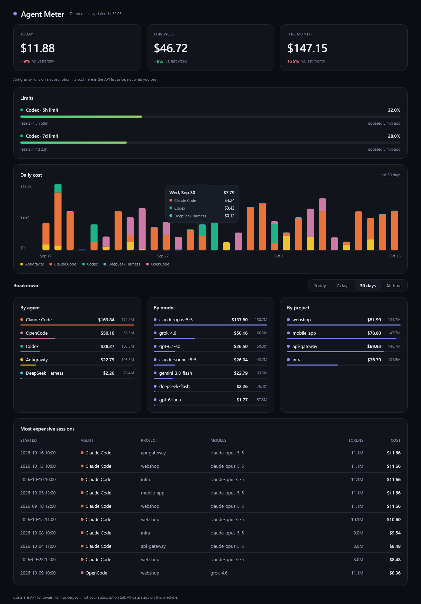

# Agent Meter

<p>
  <a href="https://github.com/jimmy211245/agent-meter/actions/workflows/ci.yml"></a>
  <a href="../../releases/latest"></a>
  <a href="LICENSE"></a>
  
  
</p>

**What do your AI coding agents actually cost? Agent Meter shows it — locally, in one dashboard.**
It reads the session logs that **Claude Code**, **OpenAI Codex CLI**, **OpenCode**, **DeepSeek Harness** and **Google Antigravity**
already write to disk, adds up tokens and cost per day, agent, model and project, and warns you before a rate limit runs out.
Windows, macOS and Linux. Open source (MIT), no account, no telemetry.

<p align="center">
  <picture>
    <source media="(prefers-color-scheme: light)" srcset="docs/screenshot-light.png">
    
  </picture>
</p>

The UI follows your system's light or dark setting.

> **Costs are API list prices, not your subscription bill.** If you use a Claude, ChatGPT or Antigravity plan you pay the
> plan fee; the numbers show what the same usage would cost through the API.

## Features

- Cost today / this week / this month
- Breakdown per agent, model and project, plus a 30-day history chart
- The most expensive sessions
- New sessions appear live (logs are re-checked every 5 seconds)
- **System tray:** the icon is green normally, yellow once a limit reaches the first threshold and red at the second.
  Hover for today's cost and the highest limit per agent (window, percent, reset time in your system's date/time format);
  the menu has *Open dashboard* and *Quit*. Closing the window hides it in the tray (`"minimizeToTray": false` to quit instead).
  A desktop notification appears when a threshold is newly crossed — once per window and reset cycle for each threshold,
  never for windows that have already reset, and not for limits that were already exceeded when the app started.
  If the OS has no system tray the app runs as a normal window and logs one line to `agent-meter.log`.
- Editable price table — no prices are hard-coded
- **Limit warnings (Codex):** shows the 5 h and 7 d rate-limit windows with a progress bar, reset time and age of the
  last reading, and a banner when a window reaches a threshold (orange at 80 %, red at 95 % by default).
  Once a window's reset time has passed the bar shows "Reset, waiting for new data" instead of an outdated percentage.
  Everything is configured in `~/.agent-meter/settings.json` (created on first start with these defaults):

  ```json
  {
    "warningThresholds": [80.0, 95.0],
    "minimizeToTray": true,
    "startMinimized": false
  }
  ```

  Any list of percentages works; the highest one reached is reported. The first threshold is a warning (yellow),
  the second and any higher one is critical (red).
  The data comes from the `rate_limits` field Codex writes into its session logs, so it is as fresh as your last Codex request.

## Privacy

- **Everything stays on your machine.** No network access, no telemetry, no accounts.
- **Your prompts and answers are not read into the app's database.** Only numbers and metadata are stored: agent, session id, model, project path, timestamp, token counts.
  Source databases (OpenCode, Antigravity) are opened strictly read-only and never modified.
- Data lives in `~/.agent-meter/` (`agent-meter.db`, `prices.json`, `settings.json`, `agent-meter.log`).
  Delete that folder to reset. Set `AGENT_METER_HOME` to use another location.

## Install

**Download** the latest installer from the [Releases page](../../releases/latest):

| OS | File | Notes |
|---|---|---|
| Windows | `AgentMeter-<version>.msi` | not code-signed yet: SmartScreen may ask you to confirm ("More info" → "Run anyway") |
| macOS (Apple silicon) | `AgentMeter-<version>.dmg` | not notarized yet: right-click the app → Open the first time |
| Linux | `agentmeter_<version>_amd64.deb` | `sudo apt install ./agentmeter_*.deb` |
| any (Java 21) | `AgentMeter-<os>-<arch>-<version>.jar` | `java -jar AgentMeter-*.jar` (the macOS jar is numbered 1.y.z while the version is 0.y.z) |

**Build from source** (needs JDK 21, e.g. [Temurin](https://adoptium.net/)):

```bash
git clone <repo-url> agent-meter
cd agent-meter
./gradlew run                               # Windows: gradlew.bat run
./gradlew packageDistributionForCurrentOS   # MSI / DMG / DEB for your OS, in build/compose/binaries/ (needs jpackage; WiX 3 on Windows)
./gradlew packageUberJarForCurrentOS        # single runnable JAR in build/compose/jars/
```

## Start at login

Agent Meter does not install an autostart entry itself. To start it hidden in the tray at login, set
`"startMinimized": true` in `settings.json` and add it to your OS's autostart (it needs a tray, otherwise the window opens normally):

- **Windows:** press `Win+R`, run `shell:startup`, and put a shortcut to the installed `AgentMeter.exe` there
  (or to `javaw -jar C:\path\to\AgentMeter-windows-x64-<version>.jar`).
- **macOS:** System Settings → General → Login Items → **+** → pick `AgentMeter.app`.
- **Linux:** create `~/.config/autostart/agent-meter.desktop`:

  ```ini
  [Desktop Entry]
  Type=Application
  Name=Agent Meter
  Exec=java -jar /path/to/AgentMeter-linux-x64-<version>.jar
  ```

  GNOME needs the "AppIndicator and KStatusNotifierItem Support" extension to show tray icons.

## Supported agents

| Agent | Where it reads | Format | Cost |
|---|---|---|---|
| **Claude Code** | `~/.claude/projects/**/*.jsonl` (incl. subagent logs) | JSONL | computed from `prices.json` |
| **Codex CLI** | `~/.codex/sessions/YYYY/MM/DD/rollout-*.jsonl` and archived `*.jsonl.zst`; also reads the rate limits | JSONL / zstd | computed |
| **OpenCode** | `$XDG_DATA_HOME/opencode/opencode.db` or `~/.local/share/opencode/opencode.db` (Windows, macOS, Linux) | SQLite, opened strictly read-only | the cost OpenCode records if it is above 0, otherwise computed |
| **DeepSeek Harness** | `~/.dsh/sessions/**/session.v4.jsonl.zstd` | JSONL, one zstd frame per line | computed, with DeepSeek peak/off-peak prices |
| **Google Antigravity** (app and IDE) | `~/.gemini/antigravity/conversations/*.db` and `~/.gemini/antigravity-ide/conversations/*.db` | SQLite with protobuf columns, opened strictly read-only | computed (API list prices; Antigravity itself runs on a subscription) |

Details per agent:

- **Claude Code:** `assistant` lines: `message.usage` (input, cache read, 5 min / 1 h cache write, output), `message.model`, `usage.speed`, `sessionId`, `cwd`, `timestamp`. Streamed chunks of one response share `message.id` and are counted once.
- **Codex CLI:** `token_usage_record` (deduplicated by `response_id`); for older logs `event_msg/token_count.last_token_usage`. Model from `turn_context`, project from `session_meta.cwd`.
- **OpenCode:** assistant rows of the `message` table: `tokens` (input, output + reasoning, cache read/write), `modelID`, `providerID`, `time.created`, `path.cwd`, deduplicated by message id. Only these numbers and ids are read, never message text. The database and its `-wal` file are watched, so new answers show up live.
- **DeepSeek Harness:** `assistant/message` lines: `data.usage` (input, output, cache read/write), model and provider from `data.message.source`, `time`, and the project from the first `session` line. All zstd frames of a file are read; a half-written last frame is picked up on the next scan. Deduplicated by session + `seq`.
- **Antigravity:** one database per conversation. `steps.metadata` (protobuf, decoded by a small built-in reader) holds the usage per response: input (without cache), output (thinking included), cache read/write and the timestamp. The model name comes from `gen_metadata`, the project from `conversation_summaries.db` (`workspace_uris`) or the conversation's own metadata. Deduplicated by response id; the copy of the usage in `retry_infos` is ignored. App and IDE are the same agent (`antigravity`); the folder name is stored as the source. Models without a price on Google's page (e.g. `gemini-3.7-flash`, `gemini-4-argon-trial`) stay unpriced.

Parsers ignore unknown fields and line types. Malformed lines are counted and written to
`agent-meter.log` instead of crashing the app.

## Prices

On first start `~/.agent-meter/prices.json` is created from the bundled
[`prices.json`](src/main/resources/prices.json). Edit it freely; it is re-read on every refresh.

```json
"claude-opus-5-5": { "input": 4.0, "cachedInput": 0.2, "cacheWrite": 5.0, "cacheWrite1h": 8.0, "output": 20.0,
                     "asOf": "2026-10-06", "source": "..." }
```

All values are USD per 1M tokens. A model id matches exactly or with a date snapshot suffix
(`claude-haiku-4-5-20251001` → `claude-haiku-4-5`). Models without an entry are listed as *unpriced* in the UI
and count as $0 — nothing is guessed.

Entries with `"status": "legacy-unverified"` are the last known price of a model that is no longer on the official price page.
They are used for the cost but marked "estimated" in the dashboard. Your `prices.json` always wins: models that exist
in the bundled defaults but are missing from your copy are added at runtime, your file is never rewritten.

**Aliases** (`"aliases": ["deepseek-v4.1-flash"]`) make other model names use the same price. **Peak pricing:** a model may have a
`"peak"` block with its own prices and UTC time windows; the plain fields are then the off-peak price and every response is
priced by its own timestamp. DeepSeek is configured this way (Mon–Fri 01:00–04:00 and 06:00–10:00 UTC).
Chinese public holidays are off-peak at DeepSeek but are not modelled, so those days are priced as peak (slightly too high).

**Price changes over time:** a model may have `"periods"` with `validFrom` / `validUntil` (ISO dates, UTC, both inclusive, either may
be left out). The plain fields apply unless a period contains the date of the response; the first matching period wins and every
response is priced by its own timestamp. Without periods the price is always valid. Example: Google's `gemini-3.8-flash` introductory
price doubles on 2027-01-01, and `gpt-5.6-sol` returns to 5 / 0.5 / 6.25 / 30 after its promotion that runs through 2026-11-21:

```json
"gemini-4-argon": { "input": 2, "cachedInput": 0.1, "output": 10,
                    "periods": [ { "validFrom": "2026-12-01", "input": 4, "cachedInput": 0.2, "output": 20 } ] }
```

Peak hours and periods are not combined (a model uses one or the other). Your own `prices.json` wins over the bundled one, so
delete a model's entry there to pick up changed defaults.

`grok-4.6` (xAI) uses the price for prompts under 200k tokens. xAI bills requests with 200k or more prompt tokens at twice that rate; this is not modelled, so such requests are priced too low.
If OpenCode records a cost above 0 for a response, that cost is used instead of the price table.

## Architecture

```
importers/Importer.kt        plugin interface: roots(), accepts(), parse(lines) -> UsageEvent
importers/ClaudeCodeImporter  Claude Code JSONL
importers/CodexImporter       Codex CLI JSONL / JSONL.zst
importers/OpenCodeImporter    OpenCode SQLite (read-only)
importers/DeepSeekHarnessImporter  DeepSeek Harness JSONL, multi-frame zstd
importers/AntigravityImporter Antigravity SQLite (read-only) + importers/Protobuf wire-format reader
Scanner.kt                    walks the log folders, tracks size/mtime/offset per file, reads only appended lines
Store.kt                      SQLite (events keyed by agent + response id, so re-imports never double count)
Pricing.kt                    price table + cost calculation
Stats.kt                      pure aggregation into the dashboard model
ui/Dashboard.kt               Compose Multiplatform UI
```

Adding another agent = implement `Importer` and add it to `Importers.all`.

## Roadmap

Open:

- Claude limits (same warnings for Claude Code; not implemented yet)
- GitHub Copilot and Cline importers (their local databases have token columns but were empty in tests)
- Importers for OpenAI-compatible API proxies (e.g. a local logging proxy)
- Code-signed Windows installer and notarized macOS build; Intel macOS build

## Development

```bash
./gradlew test                           # parser, pricing, aggregation and scanner tests
./gradlew run --args="--screenshot docs/screenshot.png"   # re-render the README screenshots (dark + light) from demo data
```

See [CONTRIBUTING.md](CONTRIBUTING.md). Licensed under the [MIT License](LICENSE).
